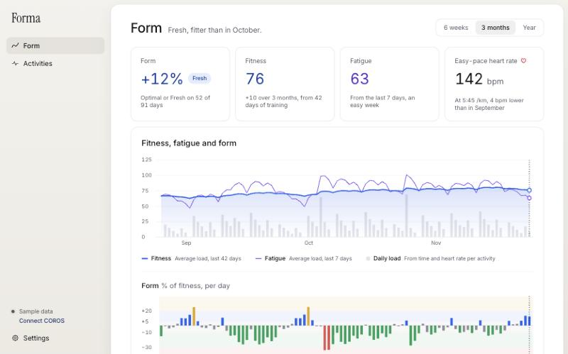
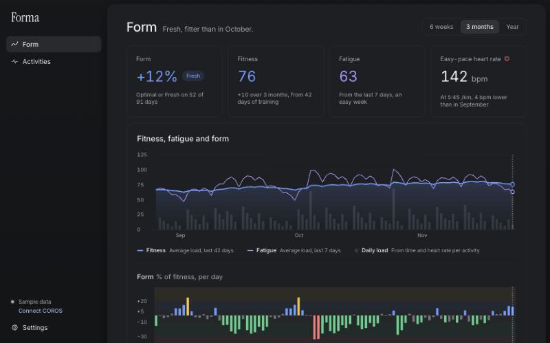
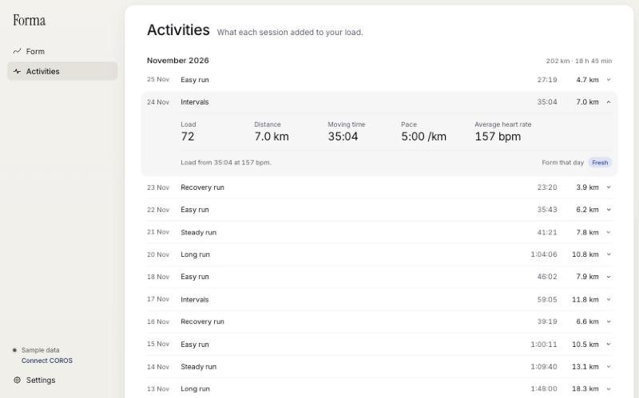

# Forma

A calm, easy-to-read view of your running **fitness, fatigue and form**, fed by your COROS watch. It answers three questions: am I getting fitter, how tired am I, and is today a day for a hard run.

Local-first: your activities stay in your browser. No account, no server that keeps your data.



<details>
<summary>Dark theme and the Activities screen</summary>





</details>

## What it shows

- **Fitness**: your average training load over the last 42 days.
- **Fatigue**: the same over the last 7 days.
- **Form**: the gap between them as a share of fitness, in five zones from High risk to Transition. Each zone opens a short guide to what it means.
- **Activities**: every session by month, with what it added to your load.
- **Day by day**: hover, tap or use the arrow keys on the charts to see a day's form, fitness, fatigue, load and activities.
- **Records** for the chosen period or everything Forma holds (5 km, 10 km, half marathon, marathon, longest run), each with its heart rate.
- **Heart rate at easy pace**, month by month: lower at the same pace means fitter.

Load comes from each activity's moving time and average heart rate (Banister TRIMP). Max and resting heart rate are estimated (resting from COROS) until you set your own in Settings. The model is Eric Banister's impulse-response model from the 1970s, the same idea behind Fitness & Freshness charts in training apps.

Forma speaks English and Polish, with light and dark themes.

## How the data gets in

Forma signs in to COROS's official MCP server (`mcp.coros.com`) with OAuth from the browser, then reads your activity list, resting heart rate and sex, a month at a time. That is all it reads: no GPS tracks, no per-activity requests. Later syncs only fetch what is new. You can also look around with sample data, no sign-in needed.

## Run it

```bash
npm install
npm run dev   # http://localhost:5174
npm test
```

COROS sign-in needs no keys: Forma registers itself with COROS on first use. It is tried on `http://localhost:5174`; other origins may not be allowed by COROS yet.

Strava sign-in exists in the code but is not wired in yet. To try it later, copy `.env.example` to `.env.local` and fill in your own Strava API app's Client ID and secret.

## Built with

Vite, React 19, TypeScript, CSS modules, hand-drawn SVG charts. Design system shared with its sister project, [Kilometr](https://kilometr-roan.vercel.app). Forma is an independent app, not made by COROS.

## Licence

MIT
